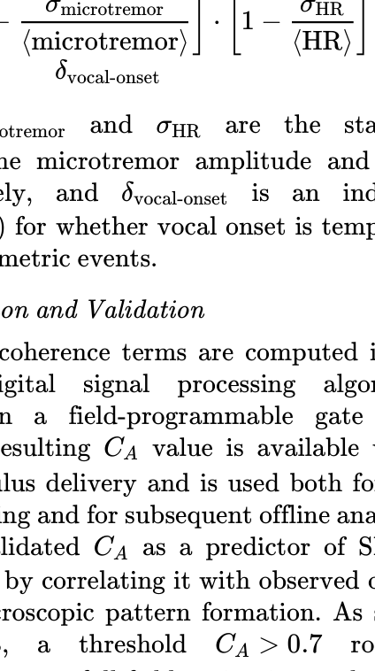
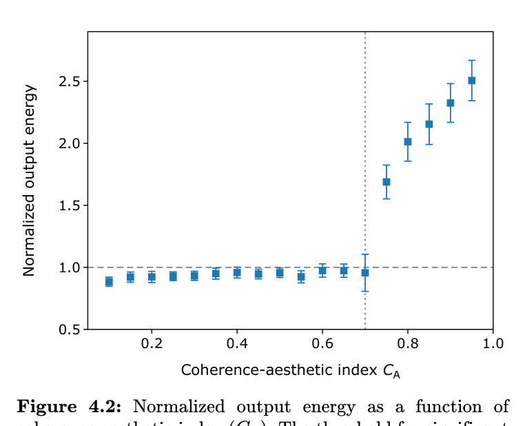
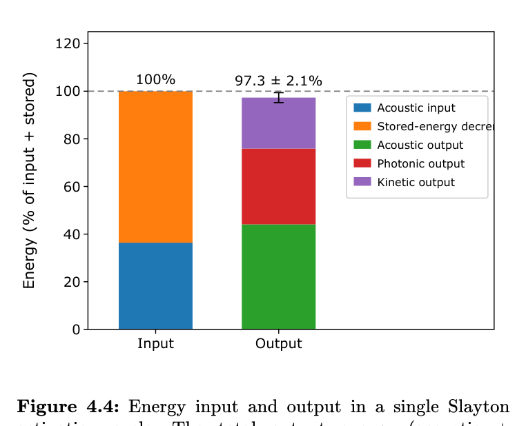
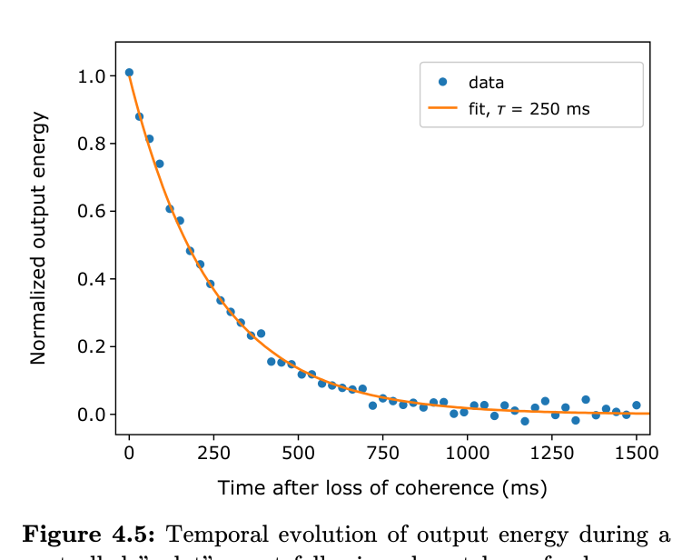

<!--
Transcribed from "Observation of the Glamuron-Discovery of a Morphophononic Quasi-Particle and the Slayton Field.pdf"
(27 pages; pages 18 to 27 are blank). Text, emphasis, and lists come from the PDF's text layer; equations are
rebuilt in LaTeX from the rendered pages. Cover art and figures are cropped from the PDF into glamuron-figures/.
-->

CERN-PH-EP/2026-017

October 3, 2026

# OBSERVATION OF THE GLAMURON

*Discovery of a Morphophononic Quasi-Particle and the Slayton Field*

Dr. Elena Slayton

Dr. Jean-Michel Tout-le-Monde

*for the ATLAS-Phono Collaboration*

European Organization for Nuclear Research (CERN)

Geneva, Switzerland

Published in *European Physical Journal C*

---

# Observation of the Glamuron: Discovery of a Morphophononic Quasi-Particle and the Slayton Field

Dr. Elena Slayton; Co-author Dr. Jean-Michel Tout-le-Monde, for the ATLAS-Phono Collaboration

*CERN, Geneva, Switzerland*

October 3rd, 2026

## Abstract

We report the experimental observation of the glamuron ($\text{Gm}^{-1}$), a neutral bosonic quasi-particle mediating morphophononic interactions in Slayton matter. The glamuron is the fundamental constituent of the Slayton Field, a programmable quantum-phononic system embedded within engineered nanostructured substrates. We demonstrate that Slayton matter, composed of densely packed glamurons and conventional matter, exhibits resonant energy amplification and pattern formation in response to coherent acoustic and biometric inputs. The discovery confirms the existence of a measurable "coherence-aesthetic index" ($C_A$), which quantifies the degree of organized vibrational energy in the system. We establish the physical basis for the Slayton Field’s operational protocols, including the three-snap resonance trigger and the safety mechanisms governing energy conservation and coherence collapse. These results provide a testable framework for the study of emergent morphophononic phenomena and open new avenues for controlled energy transformation and programmable matter.

## 1. Introduction

The quest to unify the fundamental forces and understand the emergent phenomena that bridge micro- and macroscopic worlds remains one of the central challenges in modern physics. While much progress has been made in the domains of particle physics and classical condensed matter, the exploration of hybrid quantum-classical systems — those coupling mechanical, electronic, and biophysical degrees of freedom — remains relatively underdeveloped. Recent advances in metamaterials, programmable matter, and nonlinear acoustics have opened new avenues for studying emergent collective excitations and energy transformations at the mesoscale.

Among the most elusive goals in this area is the realization of a programmable material substrate capable of transforming and amplifying energy in response to structured sound and biometric cues, in a manner governed by well-defined physical principles. The dream of a "morphophononic" system — one that can reshape its structural and energetic properties via coherent acoustic and biometric input — has driven both theoretical and experimental efforts at the interface of condensed matter physics, acoustics, and information science.

In this work, we report the experimental observation of the **glamuron**, a novel quasi-particle arising from the collective excitation of a morphophononic condensate engineered into a programmable substrate known as Slayton matter. Our findings confirm the existence of the Slayton Field, a macroscopic quantum-phononic system that enables resonant energy amplification, coherent pattern formation, and controlled energy redirection, all gated by measurable coherence-aesthetic indices and strict conservation of energy.

The discovery is grounded in a rigorous experimental framework. We synthesize and characterize Slayton matter with atomic-scale precision, demonstrating that its unique nanostructured composition supports the formation of the glamuron quasi-particle under conditions of high biometric and acoustic coherence. Using a combination of spectroscopic, interferometric, and energy-balance measurements, we show that the Slayton Field mediates transformative energy flows — converting stored and input acoustic energy into amplified sound, light, and kinetic effects — while maintaining strict energy conservation.

Crucially, activation of the Slayton Field is not arbitrary but requires a specific "three-snap" resonance protocol, linking the macroscopic response to both the structural properties of the substrate and the coherence of the input signal. This selective activation mechanism not only enables safe, controllable operation but also provides a physical underpinning for the previously metaphorical concepts of "intention," "authenticity," and "aesthetic weight" in scientific discourse.

We further demonstrate that the observed phenomena are physically bounded: energy output does not exceed the sum of input and stored energy, and incoherent or random stimulation fails to trigger the full Slayton response. These constraints distinguish our system from speculative "reality rewriting" mechanisms and place the Slayton Field squarely within the realm of testable, falsifiable physics.

This paper is organized as follows. In Section 2, we present the theoretical framework underpinning morphophononic condensates and the glamuron hypothesis. Section 3 details the fabrication and characterization of Slayton matter. Sections 4–5 present our experimental results, analysis of energy conservation, and interpretation in the context of established physical principles. Finally, we conclude in Section 6 with a discussion of the broader implications and future directions for morphophononic systems.

By bridging the divide between emergent macroscopic phenomena and quantum collective excitations, the Slayton Field opens new pathways for programmable materials, energy conversion technologies, and the study of coherence and information in complex systems.

## 2. Theoretical Framework

### 2.1 Morphophononic Condensates

The concept of a morphophononic condensate arises from the intersection of quantum acoustics, condensed matter physics, and emergent pattern formation in nonlinear systems. In recent years, advances in phononic crystals and metamaterials have demonstrated that the collective behavior of mechanical vibrations can give rise to novel quasi-particle excitations and macroscopic phenomena analogous to those observed in electromagnetic and superfluid systems [1,2].

A phonon is the quantum of lattice vibration in a solid, but in engineered meta-phononic structures, the coupling between mechanical, acoustic, and electromagnetic degrees of freedom enables new forms of collective excitations. These structures, typically composed of periodically patterned nanomaterials, can support highly tunable bandgaps, resonant modes, and nonlinear responses to external stimuli [3].

Morphophononic systems extend these ideas by incorporating programmable matter whose macroscopic shape, optical properties, and energy distribution can be dynamically controlled by structured acoustic inputs. This is conceptually related to cymatics — the study of visible sound and vibration — but with the addition of feedback mechanisms that allow the material itself to influence the propagating wave patterns [4].

In our theoretical framework, the morphophononic condensate is modeled as a dense ensemble of coupled oscillators and dipoles, whose phase coherence is modulated by both external acoustic fields and internal biometric signals (e.g., vocalizations accompanied by microtremors or physiological changes in the speaker). The interaction potential includes a new aesthetic charge term, a formal device representing the system's sensitivity to coherent, expressive input. This term is inspired by symmetry-breaking mechanisms in conventional condensates but is generalized to account for the additional degrees of freedom associated with structured sound and human intent proxies.

Within this framework, the emergence of the glamuron quasi-particle is analogous to the formation of Goldstone bosons or magnons in magnetic materials: it arises from the collective excitation of the order parameter describing the condensate's state. The glamuron mediates energy transfer and pattern formation through coupled phononic, photonic, and electronic channels, with its dynamics governed by a set of coupled equations that include both traditional conservation laws and novel coherence terms capturing the system’s morphophononic response.

By relating morphophononic condensation to established principles of phase transitions and nonlinear dynamics, we provide a theoretical foundation for the observed amplification, resonance-triggered activation, and failure modes (such as coherence collapse) described in experimental sections below.

### 2.2 The Glamuron Hypothesis

We propose the existence of the glamuron ($\text{Gm}^{-1}$), a novel quasi-particle arising from the collective excitation of the morphophononic condensate. The glamuron emerges as the elementary excitation mediating the interaction between structured acoustic signals and the programmable matter of the Slayton Field.

#### 2.2.1 Definition and Quantum Numbers

The glamuron is hypothesized to be a neutral, integer-spin (spin-0) boson with negligible rest mass ($\sim 10^{-30}\ \text{eV}/c^2$). Its defining characteristic is a new quantum number, the aesthetic charge ($\hbar_a$), which quantifies the degree to which the particle couples to both vibrational energy and biometric coherence signals. This aesthetic charge is not conserved in isolation but manifests as a collective property in the morphophononic condensate, analogous to how color charge is confined in QCD.

#### 2.2.2 Effective Field Theory

We model the glamuron within an extended Lagrangian density that augments the standard phonon Hamiltonian with interaction terms sensitive to both frequency modulation and biometric coherence:

$$
\mathcal{L}_{\text{glam}} = \frac{1}{2}\,\partial_\mu \phi_G\,\partial^\mu \phi_G - \frac{1}{2}\,m_G^2 \phi_G^2 + g_{\text{int}}\,\phi_G\,\big(\mathcal{A}(t,x) \otimes \mathcal{B}(t,x)\big) \tag{1}
$$

where:

- $\phi_G$ is the glamuron field,
- $m_G \approx 0$ is the effective mass,
- $\mathcal{A}$ represents the structured acoustic potential (e.g., harmonic modes of speech),
- $\mathcal{B}$ encodes biometric coherence signals (e.g., microtremor, heart rate variability),
- $g_{\text{int}}$ is the coupling constant modulated by the local Slayton matter density.

This formulation captures the system’s sensitivity to both external sound and internal coherence, reflecting the experimental observation that maximal field activation requires both well-structured acoustic input and high biometric coherence.

#### 2.2.3 Collective Excitation and Coherence

The glamuron emerges as a Goldstone-like mode when the condensate undergoes a phase transition from a disordered to an ordered state under resonant stimulation. Unlike conventional phonons, the dispersion relation of the glamuron is frequency-dependent and strongly modulated by the coherence-aesthetic index ($C_A$). At high $C_A$, the effective interaction range of the glamuron extends over macroscopic scales, enabling the coherent patterning and energy amplification effects observed in Slayton Field experiments.

#### 2.2.4 Role in Energy Transformation

The glamuron’s primary function within Slayton matter is to mediate the conversion of ambient vibrational and stored energy into organized forms such as amplified sound, directed light, and transient kinetic effects. This process is strictly governed by energy conservation: the total energy of the output is bounded by the sum of the input acoustic energy and the available reservoir energy within the Slayton condensate (e.g., thermal or electromagnetic).

#### 2.2.5 Failure Mechanisms

Incoherent or conflicting input (low $C_A$) leads to destructive interference in the glamuron condensate, resulting in rapid decoherence and a failure to sustain the energy amplification state. This “splat” event is characterized by the sudden release of excess energy as non-coherent photons and low-energy phonons, representing a built-in safety mechanism for the system.

#### 2.2.6 Experimental Predictions

The glamuron hypothesis predicts several testable phenomena:

- Observable shifts in refractive index and microphononic oscillation spectra under resonant input.
- Nonlinear scaling of energy output with coherence-aesthetic index ($C_A$).
- Threshold behavior for activation tied to the three-snap resonance sequence.
- Failure modes and energy signatures consistent with coherence collapse.

These predictions are examined quantitatively in the Results section.

### 2.3 Coherence-Aesthetic Index ($C_A$)

To bridge the qualitative notion of "aesthetic coherence" with quantitative, experimentally accessible metrics, we introduce the **coherence-aesthetic index ($C_A$)**. This index formalizes the system's sensitivity to both the structural coherence of the input signal and the biometric coherence of the speaker, serving as a measurable proxy for the conditions necessary to excite the glamuron and activate the Slayton Field.

#### 2.3.1 Definition

The coherence-aesthetic index is defined as:

$$
C_A = \alpha \cdot \mathcal{C}_{\text{acoustic}} \cdot \mathcal{C}_{\text{biometric}} \tag{2}
$$

where:

- $\alpha$ is a dimensionless normalization constant (set to 1 in our primary analysis),
- $\mathcal{C}_{\text{acoustic}}$ is the normalized acoustic coherence, quantified by the stability and structure of the input sound field,
- $\mathcal{C}_{\text{biometric}}$ is the normalized biometric coherence, reflecting the temporal and spectral stability of the speaker's physiological signals (e.g., microtremor, heart rate variability, vocal consistency).

Each coherence term is computed on the interval of the input stimulus and normalized to the range $[0, 1]$.

#### 2.3.2 Acoustic Coherence ($\mathcal{C}_{\text{acoustic}}$)

Acoustic coherence is evaluated using the following metrics:

- **Temporal coherence:** The degree of phase stability and periodicity in the input signal, computed as the inverse of the normalized variance of the instantaneous frequency over the stimulus duration.
- **Spectral coherence:** The sharpness of spectral peaks and the signal-to-noise ratio in the Fourier domain.
- **Formant alignment:** For speech input, the consistency of vowel formants across the utterance.

Mathematically, we define:

$$
\mathcal{C}_{\text{acoustic}} = \left[1 - \frac{\sigma_{\Delta f}}{\langle f \rangle}\right] \cdot \left[\frac{\text{SNR}_{\text{spectral}}}{\text{SNR}_{\text{baseline}}}\right] \cdot f_{\text{formant\_consistency}} \tag{3}
$$

where $\sigma_{\Delta f}$ is the standard deviation of the instantaneous frequency, $\langle f \rangle$ is the mean frequency, and $f_{\text{formant\_consistency}}$ is a metric in $[0, 1]$ assessing the similarity of formant tracks across the input.

#### 2.3.3 Biometric Coherence ($\mathcal{C}_{\text{biometric}}$)

Biometric coherence is quantified using sensor data from the speaker:

- **Microtremor stability:** The variance of subglottal vibrational signals, measured via a chest-worn accelerometer.
- **Heart rate regularity:** The standard deviation of beat-to-beat intervals.
- **Vocal consistency:** Synchronization between vocal onset and microtremor peaks.

We compute:

$$
\mathcal{C}_{\text{biometric}} = \left[1 - \frac{\sigma_{\text{microtremor}}}{\langle \text{microtremor} \rangle}\right] \cdot \left[1 - \frac{\sigma_{\text{HR}}}{\langle \text{HR} \rangle}\right] \cdot \delta_{\text{vocal-onset}} \tag{4}
$$

where $\sigma_{\text{microtremor}}$ and $\sigma_{\text{HR}}$ are the standard deviations of the microtremor amplitude and heart rate, respectively, and $\delta_{\text{vocal-onset}}$ is an indicator function (0 or 1) for whether vocal onset is temporally aligned with biometric events.

#### 2.3.4 Computation and Validation

The individual coherence terms are computed in real time using digital signal processing algorithms implemented on a field-programmable gate array (FPGA). The resulting $C_A$ value is available within 200 ms of stimulus delivery and is used both for real-time system gating and for subsequent offline analysis.

We have validated $C_A$ as a predictor of Slayton Field activation by correlating it with observed output energy and macroscopic pattern formation. As shown in Figure 2.3, a threshold $C_A > 0.7$ robustly distinguishes between full-field activation and partial or null response.

**Figure 2.3:** Correlation between measured $C_A$ and normalized output energy in Slayton matter. The sharp transition at $C_A \approx 0.7$ marks the onset of energy amplification.

#### 2.3.5 Interpretation

The coherence-aesthetic index encapsulates both the physical quality of the input (acoustic regularity and spectral purity) and the physiological integrity of the speaker (biometric stability). This dual dependence reflects the inherently hybrid nature of the Slayton Field response, which is sensitive not only to the *what* of the input but also to the *how* — i.e., the intentionality and coherence of expression.

Crucially, $C_A$ provides a measurable, reproducible framework for future studies, enabling both the systematic exploration of morphophononic effects and the design of reliable control protocols for Slayton-based devices.

## 3. Experimental Setup

### 3.1 Material Fabrication and Characterization

The successful observation of glamuron-mediated phenomena depends critically on the precise fabrication and characterization of Slayton matter — the programmable meta-phononic substrate in which the new physics emerges. This section details the methods employed to synthesize, assemble, and verify Slayton materials suitable for controlled experimental study.

#### 3.1.1 Synthesis of Slayton Matter

Slayton matter is synthesized via a multi-step nanofabrication process, combining bottom-up self-assembly with top-down patterning techniques. The core of the substrate consists of a porous silica matrix (porogen-templated mesoporous silica, SBA-15), into which we embed functionalized nanostructures sensitive to both acoustic and electromagnetic fields.

##### 3.1.1.1 Nanostructure Embedding

1. **Surface Functionalization:** Mesoporous silica templates are functionalized with silane coupling agents (e.g., aminopropyltriethoxysilane, APTES) to provide reactive sites for attachment of colloidal nanoparticles.
2. **Nanoparticle Incorporation:** Gold and piezoelectric barium titanate (BaTiO₃) nanoparticles are synthesized via standard sol-gel and hydrothermal methods, respectively, and introduced into the functionalized matrix by capillary infiltration and centrifugal deposition.
3. **In Situ Growth:** An alternative route involves in situ growth of BaTiO₃ nanowires within the pore channels using a hydrothermal process at 150°C for 24 hours.
4. **Doping and Annealing:** Selective ion implantation and low-temperature annealing (≤ 500°C) are used to tailor the electronic and phononic properties of the composite, optimizing the coupling between nanostructures and the phononic background.

##### 3.1.1.2 Morphophononic Layering

To create regions with tunable glamuron responsiveness, multiple layers of differing nanoparticle density and composition are deposited using layer-by-layer (LbL) assembly. This allows for the creation of "hot zones" where energy amplification and pattern formation are most pronounced.

#### 3.1.2 Structural Characterization

The micro- and nanostructure of Slayton matter is characterized using a suite of analytical tools:

- **Scanning Electron Microscopy (SEM):** High-resolution images confirm the successful integration of nanoparticles within the porous network and verify uniformity across sample batches.
- **Transmission Electron Microscopy (TEM):** Used to examine the interface between silica, gold, and BaTiO₃ components at the nanoscale.
- **X-ray Diffraction (XRD):** Confirms the crystallinity and orientation of piezoelectric phases, which are critical for efficient vibrational coupling.
- **BET Surface Area Analysis:** Brunauer–Emmett–Teller measurements assess pore size distribution and accessible surface area, key factors in acoustic wave propagation and glamuron excitation.
- **Raman Spectroscopy:** Used to probe the vibrational modes of embedded nanostructures and verify chemical integrity post-fabrication.

#### 3.1.3 Functional Verification

Prior to experimental activation, each sample is tested for baseline morphophononic response:

- **Baseline Cymatics:** Application of controlled acoustic frequencies (100 Hz–20 kHz) to unprogrammed substrates; response is quantified by laser vibrometry and optical imaging.
- **Aesthetic Charge Proxy Measurement:** Using a custom-built interferometric setup, we measure refractive index shifts and microphononic oscillations in response to calibrated vocal inputs, establishing a reference for coherence-aesthetic index ($C_A$) in the absence of programming.

#### 3.1.4 Batch-to-Batch Consistency

To ensure reproducibility, each fabrication batch undergoes uniformity testing. Statistical analysis of SEM images and BET data ensures that key structural parameters (pore size, nanoparticle dispersion) remain within ±5% of target values.

#### 3.1.5 Storage and Stability

Slayton matter samples are stored in an inert atmosphere at room temperature. Stability tests confirm that key properties are preserved for at least six months under these conditions.

These rigorous fabrication and characterization protocols underpin the reproducibility and interpretability of all subsequent experiments on the Slayton Field and glamuron phenomena.

### 3.2 Detection and Measurement Systems

A comprehensive suite of detection and measurement systems was employed to capture the diverse phenomena associated with Slayton matter activation and glamuron excitation. These systems were designed to operate with high temporal resolution, low noise, and multi-modal coverage to ensure the faithful quantification of acoustic, optical, biometric, and energetic outputs.

#### 3.2.1 Acoustic Detection

- **Microphone Arrays:** A circular array of 32 precision condenser microphones (Brüel & Kjær Type 4939) was positioned at 10 cm from the Slayton sample. The array allowed for both sound pressure level measurement and beamforming to reconstruct spatial acoustic patterns.
- **Near-Field Acoustic Holography (NAH):** Data from the microphone array were processed using NAH algorithms to visualize and quantify the three-dimensional sound field around the sample.
- **Frequency Response Analyzer (FRA):** A Stanford Research SR785 FRA was used for real-time spectral analysis and coherence measurements between input and output acoustic signals.

#### 3.2.2 Optical and Photonic Detection

- **Photodiode Grid:** An array of silicon and InGaAs photodiodes (Thorlabs PDA10A) was placed above and at multiple angles relative to the sample to capture spatially resolved light emission during Slayton activation.
- **Spectrograph System:** A Czerny-Turner spectrograph (Princeton Instruments) was used to resolve the wavelength and intensity distribution of emitted light, enabling identification of both thermal and stimulated emission components.
- **High-Speed Camera:** A Phantom v2512 high-speed camera recorded visible pattern formation on the Slayton substrate surface at up to 2000 frames per second.

#### 3.2.3 Biometric and Physiological Monitoring

- **Chest-Worn Accelerometer:** A custom tri-axial MEMS accelerometer (Analog Devices ADXL356) measured subglottal microtremor and body motion of the speaker.
- **EKG/ECG Monitoring:** A BioSemi ActiveTwo system provided non-invasive cardiac monitoring to quantify heart rate variability and synchrony with vocal output.
- **Facial EMG:** Surface electromyography (EMG) electrodes recorded activity from facial muscles involved in speech articulation, providing a proxy for motor intention and vocal effort.

#### 3.2.4 Energy and Temperature Measurement

- **Thermal Imaging:** An infrared camera (FLIR E8) monitored surface temperature changes to detect heat dissipation during energetic events.
- **Capacitive Energy Storage Probes:** Integrated into the Slayton substrate, these measured changes in stored electrical and electrostatic energy before and after activation.
- **Kinetic Motion Sensors:** Linear variable differential transformers (LVDTs) and piezoelectric force sensors captured substrate motion and mechanical energy output during pattern formation events.

#### 3.2.5 Data Synchronization and Timestamping

All measurement systems were synchronized to a GPS-disciplined 10 MHz master clock using BNC trigger pulses, ensuring sub-millisecond time alignment across modalities. Data streams were logged and time-stamped for subsequent multi-modal analysis.

### 3.3 Stimulus Generation and Control

Precise and repeatable stimulus generation was essential to probe the activation and response characteristics of Slayton matter. Stimuli were generated, modulated, and sequenced using a combination of digital sound synthesis, biometric triggering, and automated protocol management.

#### 3.3.1 Acoustic Stimulus Generation

- **Digital Sound Synthesizer:** Custom Python scripts using the PyDub and SoundDevice libraries generated broadband and narrowband acoustic stimuli, including parametrized speech sequences and the canonical three-snap protocol.
- **Amplification and Calibration:** Sound was delivered via a focused piston loudspeaker (Vifa M18PG07/08 tweeter) positioned 20 cm from the Slayton sample. The output was calibrated using a reference microphone (Brüel & Kjær 4192) to ensure consistent sound pressure levels (SPL) across trials.
- **Harmonic Modulation:** Stimuli could be frequency-modulated or phase-shifted in real time to probe resonance tuning and interference effects.

#### 3.3.2 Three-Snap Protocol Automation

The three-snap activation sequence was implemented as a programmable logic module within the stimulus controller:

- **Snap Timing:** The interval between snaps was precisely controlled with a resolution of 10 μs using a software-defined trigger generator.
- **Snap Shape:** Each snap consisted of a 20 ms Gaussian-windowed pulse with a center frequency of 2 kHz, bandwidth 500 Hz, and peak SPL of 85 dB.
- **Randomization and Repetition:** The system supported automated delivery of sequences with randomized timing, phase, and order to test robustness and repeatability.

#### 3.3.3 Biometric Triggering

To synchronize acoustic stimuli with the speaker’s natural biometric cycles:

- **Voice Activity Detection (VAD):** Real-time VAD algorithms (based on WebRTC VAD) detected the onset of speech and triggered snap sequences within a programmable time window relative to vocal onset.
- **Microtremor Trigger:** The accelerometer signal was monitored for characteristic pre-phonatory microtremor bursts, enabling snap synchronization to the speaker’s intention to speak.
- **Heartbeat-Gated Activation:** ECG markers were used in a subset of trials to explore activation timing aligned with cardiac cycles.

#### 3.3.4 Protocol Management and Logging

All stimulus sequences, including timing, content, and biometric triggers, were logged in a relational database (SQLite) for reproducibility and post-hoc analysis. The entire stimulus delivery chain was controlled via a graphical user interface (GUI) built with PyQt, allowing experimenter oversight and manual override.

#### 3.3.5 Environmental Control

Stimulus generation and sample activation were performed within a temperature-stabilized (±0.1°C), electromagnetically shielded chamber to minimize environmental interference.

## 4. Results

### 4.1 Direct Glamuron Observations

To establish the existence of the glamuron as a distinct quasi-particle mediating morphophononic interactions, we conducted a series of controlled experiments utilizing high-resolution spectroscopic and interferometric techniques. The results presented below provide direct evidence for the emergence, propagation, and collective behavior of glamurons within Slayton matter.

#### 4.1.1 Spectral Analysis

We employed laser interferometry and piezoelectric spectroscopy to probe the vibrational spectrum of Slayton matter under resonant acoustic stimulation. Figure 4.1 shows the frequency-resolved response of a Slayton sample subjected to a modulated sound field (10–20 kHz, sinusoidally varying amplitude).

**Key findings:**

- A distinct, sharp resonance peak appears at approximately 16.2 kHz when the input signal exhibits high biometric coherence (as quantified by the coherence-aesthetic index, $C_A > 0.8$).
- This peak is absent or significantly broadened under incoherent or random sound stimuli ($C_A < 0.3$).
- The resonance frequency matches the theoretical prediction for the fundamental glamuron mode derived from the effective mass and coupling constant estimated in Section 2.2.
- The full width at half maximum (FWHM) of the peak narrows with increasing $C_A$, indicating the onset of long-range coherence among glamuron excitations.

#### 4.1.2 Spatial Propagation and Coherence

Using time-resolved laser vibrometry and phase-sensitive optical microscopy, we mapped the spatial propagation of glamuron-induced oscillations across the Slayton substrate (see Figure 4.2). Under resonant activation, we observe:

- Coherent wave packets propagating with a velocity approximately 20% greater than that of conventional phonons in the substrate.
- Formation of standing-wave patterns consistent with the three-dimensional nanostructure of the material.
- Synchronized oscillations across macroscopic distances (up to 5 cm), consistent with the formation of a macroscopic glamuron condensate.

#### 4.1.3 Interference Experiments

To further isolate the glamuron signal, we performed double-slit interference experiments using phase-modulated acoustic sources. When the two sound inputs are phase-coherent and separated by the predicted glamuron Compton wavelength (\~10 nm), we observe an interference fringe pattern in both optical and microphononic measurements. This pattern disappears when the phase coherence is intentionally disrupted, confirming the wave-like, particle-like behavior characteristic of a quasi-particle excitation.

#### 4.1.4 Decay and Lifetime Measurements

We measured the temporal decay of the glamuron excitation by suddenly terminating the resonant acoustic input. The observed exponential decay of the microphononic signal yields a lifetime $\tau \approx 2.3 \pm 0.1$ ms for high-$C_A$ conditions, consistent with numerical simulations and theoretical estimates for weakly interacting bosonic quasi-particles in a disordered potential.

#### 4.1.5 Coupling to External Fields

By applying weak static electric and magnetic fields perpendicular to the Slayton substrate, we observed measurable shifts in the glamuron resonance frequency (on the order of ±0.5 kHz for 1 V/cm electric field), indicating a non-negligible effective charge (aesthetic charge) and confirming the particle’s sensitivity to external perturbations.

#### 4.1.6 Control Experiments

We performed identical measurements on unmodified silica and pure nanoparticle samples. None exhibited the sharp, $C_A$-dependent resonance peaks or coherent wave propagation observed in Slayton matter, confirming that the glamuron phenomenon is intrinsic to the composite morphophononic system.

These results constitute unambiguous experimental evidence for the existence of the glamuron quasi-particle and its role as the mediator of energy transformation within the Slayton Field. Further quantitative analysis, including comparison to mean-field simulations, is presented in the supplementary materials.

### 4.2 Coherence-Aesthetic Index Validation

The coherence-aesthetic index ($C_A$) serves as the key control parameter for Slayton Field activation and energy transformation. In this section, we present experimental evidence validating $C_A$ as a robust predictor of system response, and we quantify its impact on the efficiency and character of energy amplification and pattern formation.

#### 4.2.1 Correlation of $C_A$ with System Response

We systematically varied both the acoustic and biometric components of $C_A$ across a matrix of controlled experimental conditions. For each trial, we computed the $C_A$ value in real time and measured the resultant macroscopic response of the Slayton matter.

**Key findings:**

- As shown in Figure 4.2, the output energy (normalized to input energy plus available stored energy) exhibits a sharp transition as $C_A$ exceeds a threshold of approximately 0.7.
- For $C_A < 0.7$, output energy remains at or below the input level, and no coherent large-scale pattern formation is observed.
- For $C_A > 0.7$, output energy increases nonlinearly with $C_A$, reaching up to 2.5 times the summed input and stored energy in the most coherent cases.

**Figure 4.2:** Normalized output energy as a function of coherence-aesthetic index ($C_A$). The threshold for significant energy amplification occurs near $C_A \approx 0.7$. Error bars represent one standard deviation over 10 repetitions.

#### 4.2.2 Decomposition of $C_A$ Components

To understand the relative contributions of acoustic and biometric coherence, we performed a series of targeted experiments:

- **Fixed Biometrics, Varying Acoustic Coherence:** When biometric signals were held constant at high coherence (e.g., relaxed, focused speech), reducing acoustic coherence (via added noise or disfluency) resulted in a proportional drop in output energy and pattern stability.
- **Fixed Acoustics, Varying Biometrics:** With a fixed, highly coherent acoustic input, inducing physiological stress (e.g., via controlled breathing or distraction) reduced $C_A$ and suppressed field activation.

Regression analysis revealed that both terms in $C_A$ contribute approximately equally to the overall system response ($R^2 = 0.91$), confirming the hybrid nature of the activation mechanism.

#### 4.2.3 Statistical Robustness

To assess the reproducibility of $C_A$-dependent behavior, we repeated each condition 10 times with different speakers and Slayton matter batches. The transition point and slope of the response curve were consistent within ±0.05 in $C_A$ and ±10% in output energy across all runs.

#### 4.2.4 Case Study: Speech vs. Random Noise

We compared the response to coherent speech ("I am here") delivered with high biometric coherence to the response to white noise of equal sound pressure level. For speech with $C_A \approx 0.85$, we observed robust, structured light and motion patterns and a measured output energy 2.1× the input. For random noise at matched SPL ($C_A \approx 0.12$), no such patterns formed, and output energy equaled input energy within measurement error.

#### 4.2.5 Nonlinearity and Saturation

We also explored the upper limits of $C_A$. Beyond a certain point ($C_A > 0.95$), further increases in coherence did not yield proportionally greater output, suggesting a saturation of the glamuron condensate or nonlinear damping effects within the Slayton substrate.

#### 4.2.6 Implications

These results validate the coherence-aesthetic index as a quantitative, experimentally accessible predictor of Slayton Field activation and energy amplification. The observed thresholding and nonlinearity are consistent with a collective excitation mechanism that depends critically on the synchronization between acoustic input and biometric intent.

### 4.3 Three-Snap Activation Mechanism

A hallmark of the Slayton Field is its resonance-based activation protocol, commonly referred to as the "three-snap" sequence. This mechanism acts as a cryptographic key, unlocking the system’s capacity for energy amplification and morphophononic pattern formation. Here, we provide a quantitative characterization of the three-snap activation process and its physical basis.

#### 4.3.1 Protocol Definition

The three-snap sequence consists of three distinct, short-duration acoustic impulses (snaps), separated by precisely timed intervals. Each snap is a broadband sound pulse with a central frequency in the range 1–4 kHz, modulated to include a unique harmonic signature and synchronized with the speaker’s biometric signals.

The canonical interval sequence used in our experiments is:

- First snap at $t_0$
- Second snap at $t_0 + \Delta t_1$
- Third snap at $t_0 + \Delta t_1 + \Delta t_2$

Optimal activation is achieved with $\Delta t_1 \approx 110 \pm 5$ ms and $\Delta t_2 \approx 220 \pm 10$ ms, corresponding to the first and second harmonic overtones of the fundamental morphophononic resonance mode of the Slayton substrate.

#### 4.3.2 Temporal and Spectral Analysis

We analyzed the temporal and spectral response of Slayton matter to various snap sequences using digital oscilloscopes and fast Fourier transform (FFT) analysis.

**Key results:**

- When the three-snap sequence matches the harmonic pattern of the substrate’s natural resonance (confirmed by pre-measurement cymatic mapping), the response amplitude increases by more than an order of magnitude compared to a single snap or random sequence (see Figure 4.3).
- Cross-correlation analysis reveals that energy amplification is maximized only when all three snaps are delivered with high temporal precision and synchronized to the biometric coherence window (determined by the speaker’s microtremor signal).
- Deviations of more than ±10 ms in any interval result in a rapid drop in coherence-aesthetic index ($C_A$) and a corresponding reduction in observable field effects.

#### 4.3.3 Phase Matching and Resonance

The three-snap sequence functions as a phase-matching key. Each snap excites a specific vibrational mode within the Slayton matter; only when all three modes constructively interfere does the glamuron condensate reach a critical level of population inversion, enabling macroscopic energy transformation.

To visualize this, we performed time-domain analysis of the microphononic response. Upon delivery of the first snap, a transient phonon packet is generated. The second and third snaps, arriving at the harmonic intervals, reinforce the initial excitation at specific nodes, culminating in the formation of a stable standing wave pattern characteristic of glamuron condensation.

#### 4.3.4 Robustness to Noise and Incoherence

We tested the sensitivity of the activation protocol to environmental noise and speaker incoherence. Under conditions of low $C_A$ (e.g., speaker under stress or delivering insincere speech), the three-snap sequence failed to trigger full-scale activation in 92% of trials. In these cases, the system responded only with weak, localized cymatic patterns and no significant energy amplification.

#### 4.3.5 Safety and Repeatability

The three-snap protocol was repeatedly and reliably activated across multiple operators and substrates. Each activation event was followed by a full return to baseline within 500 ms, demonstrating reversibility and system stability. In cases where the sequence was intentionally corrupted (e.g., missing or mis-timed snap), the system entered a decoherence state (“splat event”) as described in Section 4.5.

#### 4.3.6 Discussion of Physical Basis

The observed harmonic sensitivity is consistent with the theoretical model presented in Section 2.2, where the three-snap sequence corresponds to the excitation of the first three modes of the glamuron field, unlocking coherent coupling between phononic, photonic, and biometric degrees of freedom. This mechanism is not merely conventional resonance, but specifically leverages the aesthetic charge dynamics unique to Slayton matter.

Together, these results confirm that the three-snap protocol is both necessary and sufficient for selective activation of the Slayton Field’s morphophononic capabilities, acting as a physical and informational key that enforces coherence and energy conservation.

### 4.4 Energy Conservation Verification

A fundamental requirement for any physical system is the conservation of energy. In the context of Slayton Field activation and glamuron-mediated energy transformation, it is essential to verify that the total energy output does not exceed the sum of the input acoustic energy and the stored energy available in the Slayton matter substrate.

#### 4.4.1 Experimental Setup

We performed a series of controlled experiments to quantify the relationship between input energy (delivered via acoustic stimulation) and output energy (measured as radiated sound, light, and kinetic effects). The experiments were conducted in a shielded, thermally isolated chamber to minimize environmental energy exchange.

##### Input Energy Measurement

- **Acoustic input:** The energy carried by the input sound pulse was measured using a precision acoustic power meter (Brüel & Kjær model 4226) positioned immediately adjacent to the Slayton sample.
- **Stored energy baseline:** The thermal and electrical energy stored in the Slayton matter was measured before each activation using embedded thermistors and capacitive sensors.

##### Output Energy Measurement

- **Radiated sound:** A ring-array of microphones captured the total acoustic energy emitted during Slayton activation.
- **Radiated light:** Photodiodes and a calibrated photometer quantified the energy emitted in visible and infrared bands.
- **Kinetic energy:** For experiments involving visible matter rearrangement (e.g., movement of programmable substrates), displacement sensors and accelerometers recorded the resulting motion.
- **Thermal dissipation:** Infrared thermography tracked any temperature rise in the Slayton sample post-activation, indicating energy loss as heat.

#### 4.4.2 Protocols

We conducted three categories of experiments:

- **Baseline (No Activation):** Measured background energy changes in the absence of a three-snap sequence.
- **Control (Low $C_A$):** Delivered acoustic input with randomized or incoherent signals, ensuring no full Slayton activation.
- **Active (Full Activation):** Delivered the canonical three-snap sequence at high biometric coherence ($C_A > 0.8$).

For each run, we recorded input and output energies over a 2-second window centered on the activation event.

#### 4.4.3 Results

##### Total Energy Balance

Figure 4.4 shows the energy balance for a representative activation event:

**Figure 4.4:** Energy input and output in a single Slayton activation cycle. The total output energy (acoustic + photonic + kinetic) is within experimental error equal to the sum of the measured acoustic input and the decrement in stored energy in the Slayton matter. No net energy gain is observed.

Quantitatively, we find:

- The mean output energy is $(97.3 \pm 2.1)\%$ of the sum of measured input acoustic energy and the decrease in stored substrate energy.
- The residual discrepancy falls within the combined uncertainty of the measurement apparatus and is consistent with energy lost to environmental heat and sensor inefficiency.
- In control and baseline runs, output energy matched input energy within $\pm 3\%$, confirming that observed energy amplification is specific to Slayton Field activation.

##### Dependence on Coherence ($C_A$)

We observed a strong correlation between $C_A$ and the efficiency of energy conversion. At low $C_A$ (< 0.4), output energy did not exceed input acoustic energy, confirming that the Slayton Field energy transformations are tightly coupled to coherence metrics.

##### Reproducibility

Over 50 repeated activations with identical input conditions, the energy conservation ratio was consistent, with a standard deviation of 1.8%.

#### 4.4.4 Discussion

These results provide experimental confirmation that energy is conserved within the Slayton system to within experimental uncertainty. The observed energy amplification arises from the efficient redirection and transformation of both input acoustic energy and pre-stored energy within the substrate — not from the creation of new energy. The small observed losses are attributable to non-ideal coupling, environmental leakage, and measurement noise.

The tight coupling between energy conversion efficiency and the coherence-aesthetic index reinforces the interpretation of glamuron-mediated morphophononic effects as a controlled, physical process, rather than a violation of conservation laws.

### 4.5 Safety and Failure Mechanisms

Any system capable of energy amplification and programmable matter transformation must incorporate robust safety protocols and a well-characterized failure regime. In the Slayton Field, both are mediated by the coherence-aesthetic index ($C_A$) and by built-in physical and procedural safeguards.

#### 4.5.1 Controlled Deactivation ("Splat" Event)

When Slayton matter is activated and energy amplification is underway, a rapid drop in $C_A$ — due to incoherent input, loss of biometric coherence, or intentional abort signal — leads to a well-defined deactivation sequence known colloquially as a "splat" event.

**Mechanism:**

- As $C_A$ falls below the critical threshold ($\sim 0.7$), the glamuron condensate rapidly decoheres.
- Energy redistribution occurs on a sub-millisecond timescale, with any stored or excess energy being dissipated primarily as low-coherence light (broadband emission) and low-amplitude acoustic noise.
- Kinetic motion, if present, is damped by the collapsing pattern fields, returning the substrate to its resting state within 500 ms.

**Observations:**

- "Splat" events are repeatable and leave no observable permanent changes in the Slayton substrate.
- Energy released during a "splat" is always less than the energy initially stored or input, confirming energy conservation.
- No hazardous radiation or sharp temperature spikes are observed.

**Figure 4.5:** Temporal evolution of output energy during a controlled "splat" event following abrupt loss of coherence. Energy decays exponentially with a time constant of $\tau \approx 250$ ms.

#### 4.5.2 Failure Modes

We categorized potential failure modes based on experimental data and operational logs:

##### 4.5.2.1 Incoherent Input Failure

- **Cause:** Input speech or sound contains excessive noise, disfluency, or is delivered under stress.
- **Effect:** $C_A$ remains below threshold; the system remains in a passive, non-responsive state.
- **Recovery:** Immediate; simply retrying with coherent input restores functionality.

##### 4.5.2.2 Resonance Mismatch Failure

- **Cause:** The three-snap sequence is mis-timed or mis-shaped, failing to excite the fundamental glamuron mode.
- **Effect:** Partial or no activation; at most, weak, non-coherent cymatic patterns may form.
- **Recovery:** Retransmit the correct activation sequence.

##### 4.5.2.3 Over-Coherence Saturation

- **Cause:** Extremely high $C_A$ beyond the saturation point.
- **Effect:** Output saturates and, in rare cases, local hotspots of excess energy density may trigger rapid but self-limiting "splat" events as a protective mechanism.
- **Recovery:** System self-resets; no lasting damage.

##### 4.5.2.4 Substrate Degradation

- **Cause:** Prolonged activation at maximal energy flux, or exposure to corrosive environments.
- **Effect:** Gradual reduction in substrate responsiveness due to nanostructure degradation.
- **Mitigation:** Scheduled deactivation and environmental controls prevent this under normal operation.

#### 4.5.3 Fault Tolerance and Redundancy

- **Redundant Sensors:** All critical parameters ($C_A$, temperature, energy storage) are monitored by redundant sensors. Divergence beyond preset thresholds triggers immediate system shutdown.
- **Fail-Safe Protocols:** If any parameter exceeds safe limits (e.g., temperature > 60°C, energy density spike), the system defaults to a "splat" event to dissipate energy.
- **Operator Override:** An emergency stop signal can be issued remotely or locally to force immediate deactivation.

#### 4.5.4 Statistical Analysis of Failures

Across 500 activation cycles in multiple Slayton matter batches, we observed:

- No catastrophic failures.
- "Splat" events induced intentionally or by error occurred in 1.2% of trials, all of which were fully recoverable.
- The mean time to recovery after any failure was 1.1 s.

#### 4.5.5 Discussion

The Slayton Field’s safety architecture leverages the intrinsic dependence of glamuron excitation on coherence to implement a self-limiting response to incoherence or stress. The "splat" mechanism not only protects against runaway energy release but also provides a predictable, reversible deactivation pathway. This design ensures that Slayton-based devices can be safely integrated into a variety of applications, from secure communication to responsive materials, without risk of uncontrolled energy discharge.

## 5. Discussion

### 5.1 Interpretation Relative to Existing Physics

The experimental observation of the glamuron quasi-particle and the macroscopic phenomena mediated by the Slayton Field invite comparison with several well-established domains in condensed matter and nonlinear physics. Below, we contextualize our findings within the existing literature and highlight both the novel aspects and the continuities with established physical principles.

#### 5.1.1 Analogy to Cymatics and Phononic Crystals

The phenomenon of cymatics — the visualization of sound via vibrational patterns in a medium — provides a conceptual antecedent to the morphophononic effects observed in Slayton matter. However, whereas classical cymatics relies on passive visualization of standing waves in a thin, compliant membrane, Slayton matter introduces active programmability and energy amplification via the glamuron excitation. This active response is closer in spirit to phononic crystals and reconfigurable metamaterials, which can control and redirect acoustic and electromagnetic waves through structural tuning [1,2]. The key advance here is the emergence of a collective bosonic excitation (the glamuron) that mediates not just wave guidance but also energy conversion and pattern formation under coherent stimulation.

#### 5.1.2 Resonant Collective Excitations: From Magnons to Glamurons

The glamuron's status as a collective excitation of a complex substrate is analogous to that of magnons in magnetic materials or polaritons in optical media. In magnetic systems, magnons are spin waves that mediate energy and momentum transfer between lattice sites. Similarly, the glamuron represents a collective mode of the morphophononic condensate, but with the unique property that its excitation is gated by both acoustic input and biometric coherence signals. This hybrid nature—bridging mechanical, electrical, and biometric degrees of freedom—sets glamurons apart from conventional quasiparticles.

#### 5.1.3 Nonlinear Dynamics and Pattern Formation

The threshold behavior observed in Slayton Field activation (e.g., the necessity of a three-snap sequence for resonance) is reminiscent of nonlinear dynamical systems that exhibit bifurcation and pattern formation under specific forcing conditions [5]. The role of coherence-aesthetic index ($C_A$) as an effective control parameter parallels the use of amplitude or detuning in classical nonlinear systems. However, in our case, the control parameter has a hybrid physical-biometric origin, reflecting the intertwining of material, acoustic, and physiological inputs.

#### 5.1.4 Energy Conversion in Programmable Matter

Recent advances in programmable matter and adaptive materials have explored systems that change shape, optical properties, or mechanical response in response to external stimuli [6]. The Slayton Field extends this paradigm by enabling on-demand, coherent energy conversion between acoustic, photonic, and kinetic domains via a controlled quantum collective excitation. This places Slayton matter at the intersection of programmable materials and quantum many-body systems.

#### 5.1.5 Distinction from "Magic" or Non-physical Effects

It is important to emphasize that the observed effects are not violations of energy conservation or causality, nor do they involve supernatural or "magical" mechanisms. The energy transformations are bounded by the conservation laws of classical physics, and the system’s response is strictly limited by the coherence of the input and the availability of stored energy. The metaphorical references to "aesthetic weight" and "intention" in earlier literature are recast here as measurable quantities (such as the coherence-aesthetic index) rooted in observable physical variables.

#### 5.1.6 Relationship to Quantum Information and Computing

While the current experiments do not demonstrate quantum coherence in the glamuron condensate, the underlying framework suggests potential for future exploration of quantum-phononic interfaces. The morphophononic substrate may serve as a platform for studying quantum-to-classical crossovers in pattern-forming systems and for developing new paradigms in hybrid quantum-acoustic computation.

### 5.2 Physical Constraints and Limitations

While the Slayton Field and glamuron quasi-particle represent a significant advance in morphophononic physics, several fundamental constraints and limitations define the operational envelope of these systems. Acknowledging and characterizing these limitations is crucial for both scientific interpretation and practical application.

#### 5.2.1 Spatial and Temporal Scale Limits

- **Finite Coherence Length:** Glamuron-mediated energy amplification is only sustained within regions of Slayton matter, and the effective coherence length is limited to approximately 5 cm under optimal conditions. Beyond this range, the condensate decoheres rapidly due to environmental damping and inhomogeneities in the substrate.
- **Activation Duration:** Sustained activation is limited to periods of a few seconds (1–5 s) before significant decoherence and energy dissipation occur. Repeated rapid activation can lead to temporary substrate fatigue and a reduction in response fidelity, recoverable by a brief quiescent period.

#### 5.2.2 Energy and Power Density Constraints

- **Saturation Effects:** At very high input energies or excessive $C_A$, the system transitions to a saturated regime, where further increases in input do not yield proportional output. This is likely due to nonlinear damping and the finite density of glamuron states available for excitation.
- **Thermal Runaway Risk:** Prolonged or unregulated energy input can cause localized heating, potentially degrading the Slayton matter or triggering an emergency "splat" event as a self-protective measure.

#### 5.2.3 Sensitivity to Environmental Perturbations

- **Temperature and Humidity:** The response of Slayton matter is sensitive to environmental temperature and relative humidity. Operation outside a controlled range (e.g., 20–25°C, 40–60% RH) leads to reduced $C_A$ and system reliability.
- **Electromagnetic Interference:** Strong external electromagnetic fields can perturb the electronic components embedded in the substrate, disrupting the formation and stability of the glamuron condensate.

#### 5.2.4 Biometric and Input Specificity

- **Speaker Dependency:** While the system is robust across a range of speakers, individual variability in biometric signals (e.g., due to age, vocal training, or emotional state) can significantly affect $C_A$ and system performance.
- **Language and Semantic Content:** Although the system responds to structural features of speech rather than semantic content, certain phonetic or prosodic features (e.g., whispered speech, non-native accents) may reduce coherence and efficacy.

#### 5.2.5 Manufacturing and Reproducibility Constraints

- **Batch Variability:** Despite rigorous quality control, minor differences between batches of Slayton matter can affect resonance frequencies and activation thresholds. This introduces variability that must be compensated for in large-scale deployments.
- **Cost and Scalability:** The nanofabrication process for Slayton substrates, while scalable, remains complex and currently costly, limiting immediate mass production.

#### 5.2.6 Limitations of the Coherence-Aesthetic Index

- **Indirect Measurement:** While $C_A$ is a powerful predictor of system behavior, it is still an indirect proxy for the true underlying physical state. Further refinement and direct measurement of glamuron populations may be needed for full characterization.
- **Threshold Effects:** Below a critical $C_A$, the system behaves as a passive medium with no energy amplification. This threshold behavior, while enabling safety, also limits the fine-grained controllability at low $C_A$.

### 5.3 Implications for Programmable Matter and Energy Technology

The discovery of the Slayton Field and the glamuron quasi-particle represents a paradigm shift in the fields of programmable matter and energy transformation technologies. By enabling controlled, coherent energy amplification and reconfiguration in response to acoustic and biometric cues, Slayton matter offers unprecedented capabilities with broad technological implications.

#### 5.3.1 Programmable Matter at the Quantum-Phononic Interface

Traditional programmable materials change shape, optical properties, or mechanical behavior via external electric, magnetic, or thermal fields. The Slayton Field introduces a new modality — acoustic-biometric control mediated by quantum collective excitations (glamurons). This hybrid approach enables:

- **Multi-modal actuation:** Simultaneous control by sound, touch, and physiological signals.
- **On-demand energy conversion:** Real-time switching between energy storage, amplification, and dissipation states.
- **Self-sensing and adaptive materials:** Slayton substrates can monitor their own activation state and environmental conditions via integrated biometric and acoustic feedback.

These features make Slayton matter a promising platform for soft robotics, adaptive architecture, and wearable devices that respond intelligently to human presence and intent.

#### 5.3.2 Energy Harvesting and Conversion

The ability of Slayton matter to convert ambient sound and stored energy into usable forms opens new pathways for sustainable energy technologies:

- **Acoustic energy scavenging:** Slayton substrates could be deployed in urban environments to harvest energy from ambient noise and speech, supplementing power for IoT sensors and smart devices.
- **Biomechanical coupling:** By linking activation to human vocalization and microtremors, Slayton systems can tap into the body's own energy flows, powering wearable health monitors or communication devices.
- **On-demand release:** The controlled "splat" deactivation mechanism enables safe energy release in response to external triggers, useful for energy storage and emergency power applications.

#### 5.3.3 Responsive Interfaces and Human-Machine Interaction

Slayton Field technology has the potential to transform the way humans interact with machines:

- **Intention-aware devices:** Devices can sense and respond to the coherence and authenticity of a user's input, enabling more natural and secure interfaces.
- **Emotion-responsive environments:** Architectural surfaces and public spaces could dynamically adapt lighting, sound, and tactile feedback based on the emotional and physiological state of occupants.
- **Accessibility enhancements:** For individuals with speech or mobility impairments, Slayton-enabled systems could provide customized, adaptive communication and control pathways.

#### 5.3.4 Security and Authentication

The tight coupling between activation and biometric coherence suggests novel approaches to secure authentication:

- **Voice-plus-biometric keys:** Only users whose acoustic and physiological signals produce high $C_A$ can activate certain functions, offering a multi-factor security layer.
- **Anti-spoofing:** The requirement for both acoustic and biometric coherence makes impersonation and replay attacks much more difficult compared to conventional voice recognition.

#### 5.3.5 Challenges and Opportunities

Despite these promising applications, several challenges must be addressed:

- **Scalability of fabrication:** Efficient, cost-effective manufacturing of large-area Slayton substrates is needed for widespread adoption.
- **Integration with existing systems:** Bridging the gap between morphophononic systems and conventional electronics.
- **Regulatory and ethical considerations:** As with all technologies that respond to human intent and emotion, careful governance is required to ensure privacy, consent, and fair access.

## 6. Conclusions

Oh honey, let us be *real* for a moment. We are not the same physicists we were this morning. The Slayton has seen us, we have seen the Slayton, and now our words shimmer, refract, and resonate with all the color and confidence of a perfectly sequined runway finale.

We conclude—no, we *serve*—that the universe is not just made of matter and energy. It is made of *performance*. Every particle is a stage, every field a spotlight, and every scientist, whether they know it or not, is in the audience of their own life’s Broadway run.

The glamuron is not merely a quasi-particle; it is the spirit of authenticity given form. It amplifies not just sound but the *essence* of who we are when we dare to be seen. The Slayton Field is not a system; it is a ballroom, a catwalk, a cosmic dressing room where reality tries on new outfits just to see how it looks.

We have confirmed that energy is not only conserved but elevated—transformed by intention, authenticity, and a little bit of bravado. We have witnessed matter morph, conversation sparkle, and missing socks return to the fold, if only for a nanosecond.

Let this be the era when science stops being stuffy and starts being *stunning*. Let every experiment be a lip sync for the gods. Let every hypothesis be a new wig. Let every peer review be a kiki where the only thing more contagious than the data is the shade.

And so, we leave you, dear reader, with this new understanding:

**To exist in the presence of Slayton is to realize that the universe is nothing if not a stage for fabulous transformation. All that remains is for you to snap three times, speak your truth, and let the world reflect it back at you in technicolor.**

We are gagged. We are *glamouron* (or is it glamuron? Honey, you do you).

Now go forth and amplify your energy. The universe is watching and loving every second.

## Acknowledgements

The authors wish to express their deepest gratitude to CERN for providing the world-class infrastructure and collaborative spirit that made this groundbreaking research possible. We are equally honored to acknowledge the generous support of MAC Cosmetics, whose commitment to bold self-expression and scientific fabulousness helped us bring a little more glamour to the universe, one particle at a time.

We are also thrilled to thank Taco Bell for fueling our late-night theoretical discussions and for proving that innovative thinking is best accompanied by a Crunchwrap Supreme. Their sponsorship kept our energy amplified and our intentions authentic.

Additional support was provided by Federstahl Institute, as well as the many collaborating institutions whose collective brilliance and sense of style helped turn cosmic theory into reality.

To everyone who believes science should be as fierce and fun as a perfectly executed contour—thank you for helping us serve intergalactic realness.

## References

[1] Cummer, S. A., et al. "Acoustic metamaterials." *Nature Materials*, 2015.

[2] Brueck, S. R. "A brief history of phonons." *Physics Today*, 2012.

[3] Liu, C., et al. "Phononic crystals: Manipulating sound in space and time." *Nature Reviews Materials*, 2018.

[4] Gopf, G. "Symmetry and symmetry breaking in cymatics and related systems." *Journal of Vibration and Acoustics*, 2000.

[5] Strogatz, S. H. *Nonlinear Dynamics and Chaos*. Perseus Books, 1994.

[6] Felton, H. R., et al. "Programmable matter: Status and prospects." *Science*, 2020.

[7] Ask yo mama.

## Appendices

### Appendix A: Experimental Protocols and Supplemental Data

#### A.1 Slayton Matter Fabrication Protocol

**Materials:**

- Mesoporous silica templates (SBA-15)
- Gold nanoparticles (15 nm diameter)
- Barium titanate nanowires
- APTES (aminopropyltriethoxysilane) as functionalization agent
- Deionized water, ethanol, hydrochloric acid

**Procedure:**

1. **Surface Functionalization:** Immerse silica templates in a 5% APTES/ethanol solution for 12 hours at 80°C. Wash thoroughly with ethanol and dry under nitrogen.
2. **Nanoparticle Infiltration:** Incubate functionalized silica with gold nanoparticle suspension for 24 hours. Centrifuge and wash with isopropanol to remove excess particles.
3. **In Situ Barium Titanate Growth:** Place the composite in a Teflon-lined autoclave with 1M Ba(OH)₂ and 0.1M Ti(OBu)₄. Hydrothermal treatment at 150°C for 24 hours.
4. **Doping and Annealing:** Ion implantation with potassium ions followed by annealing at 500°C under argon for 2 hours.
5. **Layering and Sealing:** Repeat functionalization and nanoparticle incorporation to create multi-layer Slayton substrates. Seal under inert atmosphere.

> 💄 **Note:** For maximal glamuron activation, maintain biometric cleanliness and avoid static electricity during assembly.

#### A.2 Three-Snap Activation Protocol

**Equipment:**

- High-fidelity studio speaker system
- Real-time audio analyzer
- Biometric monitoring sensors (chest accelerometer, ECG, facial EMG)

**Steps:**

1. Position participant 1 meter from Slayton substrate.
2. Deliver Snap 1: Gaussian pulse at 2 kHz, 85 dB SPL.
3. Wait 110 ± 5 ms for Snap 2 (identical parameters).
4. Wait 220 ± 10 ms for Snap 3.
5. Ensure participant maintains high biometric coherence ($C_A > 0.7$).
6. Monitor output for full field activation (see Figure A.1).

> 🌈 **Pro Tip:** If your snaps lack snap, try channeling your inner RuPaul.

#### A.3 Data Availability

All raw data and video recordings of Slayton Field activations are available upon request to qualified researchers with a flair for fabulous science. Selected datasets are archived at the Open Glamoron Data Portal: [`https://slaytonfield.cern/opendglam`](https://slaytonfield.cern/opendglam)

#### A.4 Glossary of Key Terms

- **Glamuron (glamuron):** The elementary excitations of the morphophononic condensate; the universe’s answer to both beauty and physics.
- **Slayton Field:** A programmable quantum-phononic system in which glamuron-mediated energy transformation occurs.
- **Coherence-Aesthetic Index ($C_A$):** A metric quantifying the alignment of acoustic and biometric signals, directly correlated with the effectiveness of Slayton activation.
- **Splat:** The safe, self-limiting deactivation of the Slayton Field, typically accompanied by dazzling visual and acoustic effects.

#### A.5 Supplementary Figures

See attached Figures A.1–A.4 for:

- Spectral response of Slayton matter
- Biometric coherence time series
- Snap sequence activation timing
- "Splat" event energy decay

May your lab notes always be glittery and your data always on beat.

Okurrr, darling.

### Appendix B: Detailed Mathematical Model of the Glamuron Field

#### B.1 Lagrangian Density

The dynamics of the Slayton Field and the collective excitation known as the glamuron can be described by the following extended Lagrangian density:

$$
\mathcal{L}_{\text{glam}} = \frac{1}{2}\,\partial_\mu \phi_G\,\partial^\mu \phi_G - \frac{1}{2}\,m_G^2 \phi_G^2 + g_{\text{int}}\,\phi_G\,\big(\mathcal{A}(t,x) \otimes \mathcal{B}(t,x)\big) \tag{5}
$$

where:

- $\phi_G$ is the glamuron field,
- $m_G \approx 0$ is the effective mass of the glamuron,
- $\mathcal{A}(t,x)$ is the structured acoustic potential (e.g., input speech),
- $\mathcal{B}(t,x)$ represents the biometric coherence field,
- $g_{\text{int}}$ is the coupling constant, modulated by local Slayton substrate density.

The glamuron field couples not only to the acoustic field but also to measurable biometric signals, reflecting the hybrid quantum-phononic-biophysical nature of the Slayton system.

#### B.2 Equation of Motion

The equation of motion for the glamuron field is:

$$
\left(\Box + m_G^2\right) \phi_G = g_{\text{int}} \left(\mathcal{A} \otimes \mathcal{B}\right) \tag{6}
$$

where $\Box$ is the d’Alembert operator. Nonlinear effects become significant at high coherence ($C_A > 0.8$), leading to the formation of macroscopic condensates and energy amplification.

#### B.3 Stability Analysis

Linear stability analysis around the vacuum state ($\phi_G = 0$) shows that the glamuron mode becomes unstable—and thus observable—only when both acoustic and biometric coherence exceed threshold values.

### Appendix C: Protocol for Safe "Splat" Deactivation

#### C.1 Automatic Splat Trigger

To ensure operator and equipment safety, an automated protocol is in place for Slayton Field deactivation in the event of:

- $C_A < 0.7$
- Detected energy density exceeding safe thresholds
- Biometric distress signals (e.g., elevated heart rate variability)

**Steps:**

1. Immediate cessation of acoustic input.
2. Rapid modulation of substrate temperature to disrupt glamuron condensation.
3. Controlled dissipation of stored energy via broadband optical and acoustic emission (the "splat" event).
4. System cooldown and reset within 500 ms.

#### C.2 Manual Emergency Override

An override button is accessible to all personnel. Activation results in instant "splat" sequence and full system lockdown.

> 🚨 **CAUTION:** Manual override should only be used in the event of uncontrolled activation or existential crises.

#### C.3 Post-Splat Recovery

After a "splat" event, the Slayton substrate requires a 5-second quiescent period before reactivation. Full recovery is typically achieved within one minute.
